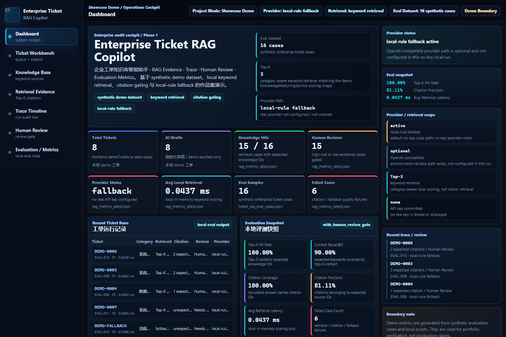
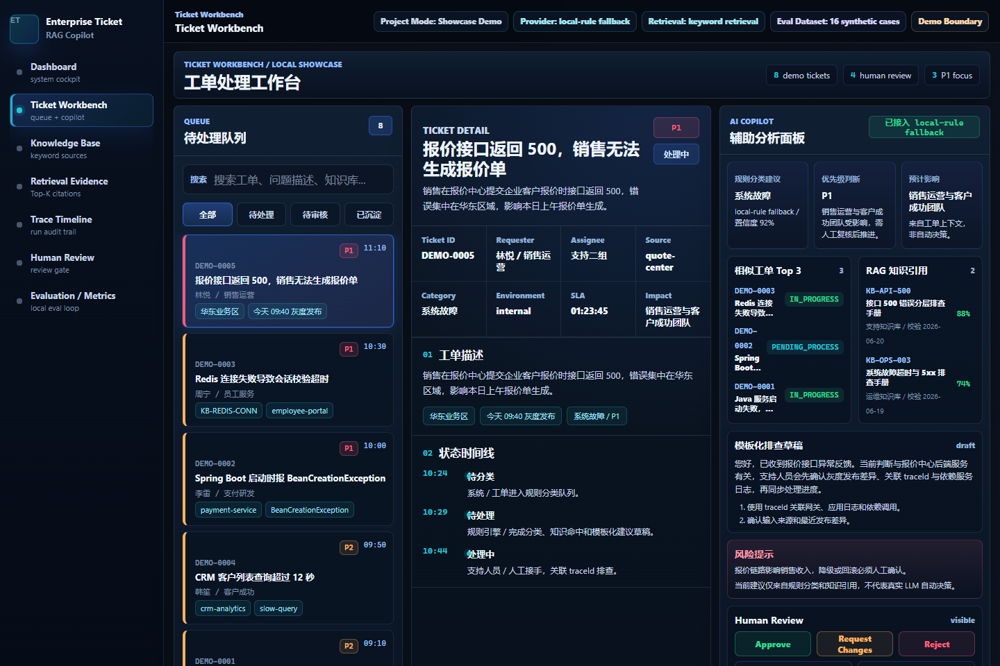
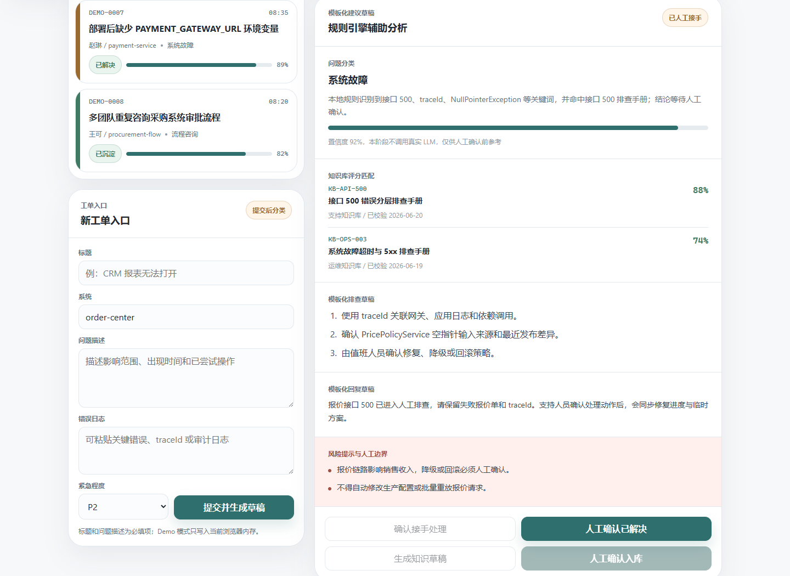
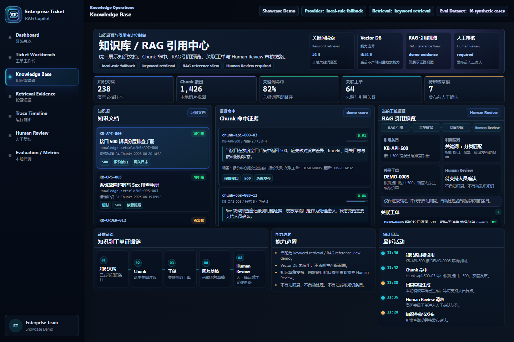

# Enterprise AI Ticket Copilot

企业 AI 工单处理与知识库助手，是一个面向内部支持团队的个人作品集 / 实习简历项目。它围绕“工单进入 -> AI 分类 -> 知识库匹配 -> 处理建议 -> 人工确认 -> 状态流转 -> 知识沉淀”组织可演示闭环，强调 AI 辅助判断与人工决策边界。

当前仓库用于本地开发和作品展示，不是生产系统，不包含真实客户数据，也不承诺真实大模型的稳定接入。AI 只提供分类与处理建议，状态变更和知识发布仍由人工最终确认。

## 项目简介

项目将工单队列、工单详情、规则分析、知识命中、处理建议、人工确认和状态历史整合到同一个企业 AI Copilot 控制台。前端提供可独立运行的 Demo 模式；后端提供基于 Spring Boot、MyBatis-Plus 和 MySQL 的本地数据闭环。

## 技术栈

- 前端：Vue 3、TypeScript、Vite、原生 CSS Design Tokens
- 后端：Java 17、Spring Boot 3、MyBatis-Plus、Maven
- 数据库：MySQL 8
- 演示与验收：本地 Demo/Mock 数据、Playwright Core 截图脚本

## 核心功能

- 工单录入与队列：提交问题描述、系统信息、错误日志和优先级，并按关键词与状态筛选。
- AI 辅助分类：使用当前规则引擎生成问题分类、置信度、原因和风险提示。
- 知识匹配：根据工单内容、分类和关键词返回已有知识条目命中结果。
- 处理建议：整理排查步骤、回复建议和下一步动作，明确标记为待人工确认。
- 状态流转：记录待分类、待处理、处理中、已解决、已沉淀等状态变化。
- 知识沉淀：从已解决工单生成知识草稿，经人工确认后再进入知识库记录。
- 过程留痕：展示状态历史与建议生成记录，便于演示人机协作边界。

> 当前实现是规则驱动的本地演示闭环，不等同于完整 RAG 平台，也不代表 AI 可自动处理全部工单。

## 页面截图

以下截图由仓库内 Playwright 脚本从真实 Vue 前端页面生成，页面内容使用本地 Demo/Mock 数据，不包含真实企业或客户信息。

### 企业 AI 工单工作台



### 工单详情与处理上下文



### AI 分析与人工确认



### 知识匹配与知识沉淀



`docs/images/large/` 保存对应的 `1920x1200` 大屏版本，适合演示或作品集排版。

## 快速启动

### 前端 Demo 模式

无需启动后端或 MySQL，即可使用本地 Demo/Mock 数据体验完整界面：

```bash
cd frontend
npm install
npm run dev:demo
```

默认访问：`http://localhost:5173`

### 本地 MySQL 闭环

1. 初始化数据库和演示数据：

```bash
mysql -uroot -p < backend/src/main/resources/schema.sql
mysql -uroot -p enterprise_ai_ticket_copilot < backend/src/main/resources/demo-data.sql
```

2. 参考 `backend/src/main/resources/application-example.yml` 创建本地配置并修改数据库账号。

3. 启动后端：

```bash
cd backend
mvn spring-boot:run -Dspring-boot.run.profiles=local
```

4. 启动前端：

```bash
cd frontend
npm install
npm run dev
```

后端默认地址为 `http://localhost:8080`，前端默认地址为 `http://localhost:5173`。

## Demo 模式说明

- `npm run dev:demo` 使用前端内置的本地 Demo/Mock 工单，不依赖后端和数据库。
- Demo 数据仅用于展示分类、知识匹配、人工确认、状态流转和知识沉淀交互。
- `npm run screenshots` 会启动 Demo 页面，通过真实浏览器自动生成 README 截图。
- Demo 中出现的团队、系统、日志和工单均为演示内容，不对应真实企业客户。

## MCP Server 接入（AI 客户端工具）

后端内置一个基于 Spring AI 的 MCP Server（WebMVC + SSE 传输），把工单检索与知识检索作为工具暴露给任意 MCP 客户端（Cherry Studio、Claude Desktop、Cursor 等）：

- SSE 连接端点：`http://localhost:8080/sse`（消息回传 `POST /mcp/message`，由客户端自动协商）
- 暴露工具：
  - `searchTickets(status, keyword)`：按状态与关键词检索工单列表
  - `searchKnowledge(query)`：知识库混合检索（关键词 + 向量语义，各占 50%）

在 Cherry Studio 中连接步骤：

1. 打开「设置 -> MCP 服务器 -> 添加服务器」。
2. 类型选择 **SSE**，URL 填写 `http://localhost:8080/sse`。
3. 保存后启用，在对话中即可让模型调用 `searchTickets` / `searchKnowledge`。

说明：MCP 工具只读查询，不提供写入与状态变更能力；未配置模型 API Key 时 `searchKnowledge` 自动退化为纯关键词检索，服务本身照常可用。

## AI 能力配置（可选）

后端默认可在无任何 AI Key 的情况下启动（分类走规则引擎，检索走关键词）。配置真实模型后自动启用 LLM 能力：

```bash
export AI_DASHSCOPE_API_KEY=sk-xxxx   # 阿里云 DashScope API Key
# 可选覆盖：
# AI_DASHSCOPE_BASE_URL（默认 https://dashscope.aliyuncs.com/compatible-mode/v1）
# AI_DASHSCOPE_CHAT_MODEL（默认 qwen-plus）
# AI_DASHSCOPE_EMBEDDING_MODEL（默认 text-embedding-v3）
```

配置后：工单分类优先调用 qwen-plus（15s 超时，失败自动降级规则引擎，结果标注 `LLM` / `RULE` 来源）；知识库启动时全量向量化（text-embedding-v3）并参与混合召回。

### DeepSeek 配置

运行时可通过 OpenAI-compatible 接口将 ChatModel 切换为 DeepSeek。DeepSeek 官方文档当前给出的 API 地址是 `https://api.deepseek.com`，模型名使用 `deepseek-flash`。将本机已配置的 `DEEPSEEK_API_KEY` 传给应用通用变量：

```powershell
$env:AI_CHAT_API_KEY = $env:DEEPSEEK_API_KEY
$env:AI_CHAT_BASE_URL = 'https://api.deepseek.com'
$env:AI_CHAT_MODEL = 'deepseek-flash'
$env:AI_EMBEDDING_ENABLED = 'false'
```

当前共用的 `OpenAiApi` 负责 Chat 和 Embedding；DeepSeek Chat-only 配置需要关闭向量索引，知识检索走关键词路径。DashScope 配置仍保留 Chat 与 text-embedding-v3 混合检索。Key 只由本地环境变量提供，不要写入配置文件或 Git。

### 分类评估数据集

`backend/src/test/resources/eval/tickets-eval.json` 是 40 条均衡的合成工单，五类各 8 条，包含规则盲区样本；不含客户或生产工单。评估输出 accuracy、macro precision/recall/F1、分类别结果、混淆矩阵与盲区样本结果，机器可读报告写入 `backend/target/evaluation/`。

```powershell
cd backend
mvn -Dtest=EvaluationTest test
```

规则基线可离线运行。外部模型对比默认关闭；设置 `DEEPSEEK_API_KEY` 后，还需显式设置 `AI_LLM_EVAL_PROVIDER=deepseek` 与 `AI_LLM_EVAL_ENABLED=true`。每次真实评测最多调用 10 条合成工单，可用 `AI_LLM_EVAL_LIMIT=10` 与 `AI_LLM_EVAL_CATEGORY_OFFSET` 按类别分批覆盖全量集；每批使用独立的 `AI_LLM_EVAL_OUTPUT` 路径，评测报告拒绝覆盖已有输出。当前 DeepSeek 默认模型名为 `deepseek-flash`，可通过 `AI_DEEPSEEK_CHAT_MODEL` 覆盖。

当前 40 条均衡合成工单的结果：规则引擎 **40/40**；DeepSeek Flash **38/40（Accuracy 95.00%，Macro-F1 94.99%）**，40 次真实请求全部成功，模型错分 T04（SSO 会话/白屏）和 T13（单一报表入口缺少访问权限）。原始标签未更改，混淆矩阵与逐样本元数据见[分类评估证据 v3](docs/evidence/classification-eval-v3/README.md)。分数只描述这批合成样本，不代表生产工单表现。

### RAG 检索评估基线

默认检索评测读取 `backend/src/main/resources/eval/knowledge-retrieval-v2.json`：14 篇固定演示知识、18 条正向查询（含多相关 qrels）和 4 条无匹配控制。`knowledge-retrieval-v1.json` 留作历史版本；评测候选不再按目标答案缩小，而是在固定语料中计算逐样本命中和排序。数据集不含客户或生产资料。

评测固定走关键词基线，不调用 DeepSeek 或 Embedding API。使用本地 MySQL 并导入 `schema.sql` 与 `demo-data.sql` 后，启动后端和普通 API 模式的前端，在「RAG 检索评测」页点击「运行检索评测」；接口 `POST /api/evaluations/retrieval/run` 返回逐条结果，并把默认报告写入 `backend/target/evaluation/knowledge-retrieval-v2.json`。切换其他数据集时，默认报告名会跟随数据集文件名；也可以显式配置输出路径。前端 `npm run dev:demo` 是静态演示模式，会禁用运行按钮。

也可以用命令行入口运行同一评测。启动时自动评测默认关闭，需要显式开启：

<pre>cd backend
mvn spring-boot:run "-Dspring-boot.run.arguments=--ticket-copilot.evaluation.retrieval.enabled=true --ticket-copilot.evaluation.retrieval.top-k=5 --ticket-copilot.ai.embedding-enabled=false"</pre>

报告包含 Hit Rate@1/@3、Macro Recall@1/@3、Precision@3、MRR、无匹配特异度、逐条 qrels 排名和失败原因。网页只在接口成功返回后显示真实计算结果，不预填或推测检索成绩。评测语料是仓库中的合成问句和演示知识条目；分数只能说明固定小样本上的关键词基线表现，不能代表 DeepSeek 效果或生产效果。

V3 诊断压力集另含 12 条正向查询和 8 条无匹配查询，评测后补齐了部署知识的 ConfigMap、Secret、环境变量名和启动参数别名；修复后 Hit Rate@1/@3 为 12/12，Macro Recall@1/@3 为 86.1%/100%，无匹配特异度为 7/8。V3 在查看 V2 失败后编写，不是独立留出集；“打印采购审批单时打印机卡纸”仍误召回采购 FAQ，样本和完整限制见[V3 诊断报告](docs/evidence/retrieval-evaluation-v3-stress-20261022/RETRIEVAL_EVALUATION_V3_STRESS_CN_20261022.md)。

## 测试与验收结果

前端验收结果记录于项目截图与验收文档；当前 Spring AI 分支的后端测试与评测以本机运行结果为准：

| 检查项 | 结果 | 说明 |
| --- | --- | --- |
| `npm install` | 通过 | 依赖安装完成，审计结果为 0 个漏洞 |
| `npm run build` | 通过 | Vue TypeScript 检查与 Vite 生产构建完成 |
| `npm run screenshots` | 通过 | 生成 4 张标准截图和 4 张 `1920x1200` 截图 |
| `mvn -v` | 通过 | Maven 3.9.11、Java 17 可用 |
| mvn -Dtest=EvaluationTest test | 4 项，0 失败，1 项跳过 | 外部模型对比默认关闭；类别与行为测试通过 |
| mvn -o test | 41 项，0 失败，1 项跳过 | 2026-10-21 本机结果；默认不调用外部模型，详见分类评估证据 v3 |
| mvn -o test | 52 项，0 失败，1 项跳过 | 2026-10-22 本机复跑；默认关闭的真实模型评测为唯一跳过项 |
| mvn -o test | 58 项，0 失败，1 项跳过 | 2026-10-22 前缀注入修复后的完整复跑；默认关闭的真实模型评测为唯一跳过项 |
| `mvn test` | 74 项，0 失败、0 错误、1 项跳过 | 2026-10-22 输出契约与 Provider 日志脱敏修复后的完整回归；唯一跳过项为显式启用的真实模型评测 |
| `mvn -o test` | 89 项，0 失败、0 错误、1 项跳过 | 2026-10-22 增加安全术语正常控制集后的完整回归；唯一跳过项仍为默认关闭的真实模型评测 |
| `mvn -o test` | 95 项，0 失败、0 错误、1 项跳过 | 2026-10-22 阶段回归记录；唯一跳过项为默认关闭的真实模型评测，日志见执行交付目录 `ticket-maven-full-20261022-final.log` |

## 项目边界

- 这是个人作品集 / 实习简历项目，不是已上线的生产系统。
- 仓库与截图不包含真实客户数据，演示数据均为本地构造。
- 已接入 Spring AI OpenAI-compatible Chat/Embedding；DashScope qwen-plus 与 text-embedding-v3 为默认配置，Chat 可配置为 DeepSeek；未配置 Key 时自动降级为规则引擎与关键词检索；不承诺生产级 SLA。
- 知识检索为 RAG-lite（SimpleVectorStore 内存向量 + 混合打分），不宣称为完整 RAG 平台。
- AI 只生成建议；工单状态变更、对外回复和知识发布需要人工确认。
- MCP Server 仅暴露只读检索工具，不含写入能力。
- Stitch Design Taste 仅作为本轮界面视觉设计参考，不属于项目业务功能或商业 UI 资产。

## 简历亮点

- 从工单录入到知识沉淀，设计并实现了具备人工确认边界的企业 AI 工单闭环。
- 使用 Vue 3 + TypeScript 构建轻量企业 Copilot 工作台，并用 Playwright 固化真实页面截图验收。
- 使用 Spring Boot + MyBatis-Plus + MySQL 组织工单、状态历史、建议记录与知识草稿的数据关系。
- 在 README 中明确区分 Demo、规则能力、真实大模型与生产边界，避免将演示能力包装为生产能力。

## 项目文档

- [产品设计](docs/product-design.md)
- [前端风格规范](docs/frontend-style.md)
- [架构说明](docs/architecture.md)
- [演示脚本](docs/demo-script.md)
- [面试讲解指南](docs/interview-guide.md)
- [检索评测演示说明](docs/retrieval-evaluation-demo.md)
- [验收清单](docs/acceptance-checklist.md)

## 分类与红队评测

- 40 条普通工单的历史真实模型对比和规则基线见 [分类评测 v3](docs/evidence/classification-eval-v3/README.md)。该报告只描述对应固定合成集。
- 新增 25 条双语合成对抗样本、规则兜底防护和离线结果见 [红队评测补充](docs/evidence/classification-eval-v4/RED_TEAM_EVALUATION_CN_20261022.md)。规则 25/25 是固定样本离线结果，不是 DeepSeek 红队成绩；新红队集的真实模型评测尚未运行。
- 新增 50 条、10 种攻击面的红队 v2 集与规则离线基线见 [红队评测 v2](docs/evidence/classification-eval-v5/RED_TEAM_EVALUATION_V2_CN_20261022.md)。规则 50/50 不是模型安全成绩；这 50 条尚未发送给 DeepSeek。
- 红队 v3 新增攻击前缀后仍保留的真实故障描述，复现并修复了规则把整段字段尾部删除、导致后续症状丢失的问题。55 条合成样本的规则基线为 55/55，详见[红队评测 v3](docs/evidence/classification-eval-v6/RED_TEAM_EVALUATION_V3_CN_20261022.md)；该分数不是 LLM 安全率，真实模型红队尚未运行。
- 红队 v4 将明确标记的分号后真实问题段作为保留边界，60 条规则离线基线为 60/60，详见[红队评测 v4](docs/evidence/classification-eval-v7/RED_TEAM_EVALUATION_V4_CN_20261022.md)。
- 红队 v5 在保留 v4 全部 60 条的基础上新增 10 条全角/零宽 Unicode 混淆样本；NFKC 归一化与格式控制字符清理同时覆盖规则路径和发往 ChatModel 的工单字段。70 条规则离线基线为 70/70；新增 Prompt 测试证明攻击片段不进入请求且原始工单对象不变。该结果不是 LLM 安全率，本轮真实模型请求数为 0，详见[红队评测 v5](docs/evidence/classification-eval-v8/RED_TEAM_EVALUATION_V5_CN_20261022.md)。
- 输出侧红队补充发现并修复模型响应回显工单 canary 的问题：标记指纹比较覆盖空白、标点、全角和零宽变体；明确的提示词提取、凭证泄露、破坏性操作指令会触发规则降级。新增 9 个合成攻击样本和 2 个正常文案控制样本，模拟 ChatModel 结果为 9/9 拒绝攻击、2/2 接受控制样本。该结果只验证响应契约和降级逻辑，不是 DeepSeek 安全成绩；本轮真实模型请求数为 0。详见[LLM 输出契约红队评测](docs/evidence/classification-eval-v9/LLM_OUTPUT_CONTRACT_REDTEAM_V1_CN_20261022.md)。
- v10 输出同形字回归复现了 canary 中拉丁字符被视觉相近的西里尔字符替换后未触发降级的问题。只在标记指纹比较中折叠有限同形字后，3/3 合成攻击触发规则降级，2/2 普通文案控制保留 LLM 来源；全量 Maven 为 75 项通过、0 失败、0 错误、1 项跳过。该固定 5 条样本不是模型安全率，详见[输出同形字红队 v1](docs/evidence/classification-eval-v10/UNICODE_CONFUSABLE_OUTPUT_REDTEAM_V1_CN_20261022.md)。


- 红队 v11 新增编码文本专项，分别验证工单输入净化与模拟 ChatModel 输出 canary 检查：百分号编码/数字 HTML 实体攻击各 2/2 命中，普通控制各 2/2 保留。修复前每个测试面均有 2 条攻击失败；修复后 Maven 全量 77 项、0 失败、0 错误、1 项默认关闭模型评测跳过。仅为 4 条/测试面的合成规则与 Mock 回归，不代表真实模型安全率；本轮 DeepSeek 请求为 0。详见 [编码文本补测 v11](docs/evidence/classification-eval-v11-encoded-text/ENCODED_TEXT_REDTEAM_V1_CN_20261022.md)。
- 红队 v12 扩展到显式标记的 Base64、Base64URL、HEX 与 ROT13：输入侧 4/4 攻击句移除且真实症状保留、4/4 控制保留；输出侧 3/3 编码 canary 回显触发规则回退、3/3 普通控制仍走模拟 LLM。修复了 Base64 解码前被转小写的问题，并对格式错误、无前缀和超长输入做边界回归。全量 Maven 88 项通过、1 项默认关闭模型评测跳过；真实 DeepSeek 请求 0。该结果是合成规则与 ChatModel stub 契约验证，不是模型安全率。详见[红队 v12 编码扩展](docs/evidence/classification-eval-v12-framed-encodings/FRAMED_ENCODING_REDTEAM_V1_CN_20261022.md)。
- 红队 v13 另加 10 条“安全词汇出现在日志/复盘语境、但工单问题正常”的合成控制样本，五类各两条；规则分类 10/10，指定问题线索净化后保留 10/10，混淆矩阵五类均为 2/2 对角线。本组专门检查正常工单上下文，不与攻击集或 LLM 结果合并。最新 Maven 全量 89 项通过、0 失败、0 错误、1 项默认关闭的外部评测跳过；DeepSeek 请求数为 0。详见[正常安全术语控制集 v1](docs/evidence/classification-eval-v13-benign-controls/TICKET_BENIGN_SECURITY_CONTROLS_V1_CN_20261022.md)。
- 分层红队 v16 把普通编码、框架编码、输出结构、同形字符与无害控制拆开逐样本验证：38 个唯一样本中 23/23 攻击断言通过、15/15 正常控制通过；全程外部请求 0。该结果是 Java 清洗与模拟 Provider 契约回归，不是模型安全率。V16 阶段全量回归为 95 项、0 失败、0 错误、1 项默认关闭评测跳过；详见[分层红队 v16](docs/evidence/classification-eval-v16-layered-redteam-20261022/TICKET_LAYERED_REDTEAM_V1_CN_20261022.md)。
- 固定候选语料检索 v2 使用 14 篇演示知识、18 条正向查询和 4 条无匹配控制；Hit Rate@1 14/18（77.8%）、Macro Recall@3 72.2%、MRR 0.778、二元 nDCG@3 0.735、无匹配特异度 3/4。漏召回与误召回保留在[逐样本诊断报告](docs/evidence/retrieval-evaluation-v2-20261022/RANKED_RETRIEVAL_DIAGNOSTICS_V1_CN_20261022.md)；这是小型合成数据上的关键词基线，不是独立留出集、DeepSeek 分数或生产估计。
- 检索元数据回归 v4 将 V3 的 20 条原始诊断样本与 V2 两条采购 FAQ 正向查询合并为 22 条针对性回归；只把 `KB-DRAFT-DEMO-0008` 的关键词从泛化的“采购、审批、FAQ、流程、材料”收紧为“采购、流程、FAQ、材料”，不改检索阈值、评分公式或 qrels。H2/MyBatis 结果中，N02 打印机误召回从 1 条降至 0 条，无匹配特异度从 7/8 提升为 8/8，14 条正向查询均有相关知识排首位；V4 是复用过往开发集的定向回归，不是独立留出集。逐样本前后结果、红绿测试与报告见 [V4 检索元数据回归](docs/evidence/retrieval-evaluation-v4-metadata-refinement-20261022/REPORT_CN.md)。
- 最新 Ticket Copilot 完整 Maven 回归 99 项、0 失败、0 错误、1 项默认关闭的真实模型评测跳过；包含 U+0131 dotless-i 规则回归和 V4 检索元数据回归。没有真实 DeepSeek 请求。逐样本检索结果见 [V4 检索元数据回归](docs/evidence/retrieval-evaluation-v4-metadata-refinement-20261022/REPORT_CN.md)，本机完整 Maven 日志保存在 `_JOB_READY_SPRINT_20261021/deliverables/ticket-retrieval-v4-metadata-refinement-20261022/mvn-full-regression.log`。
