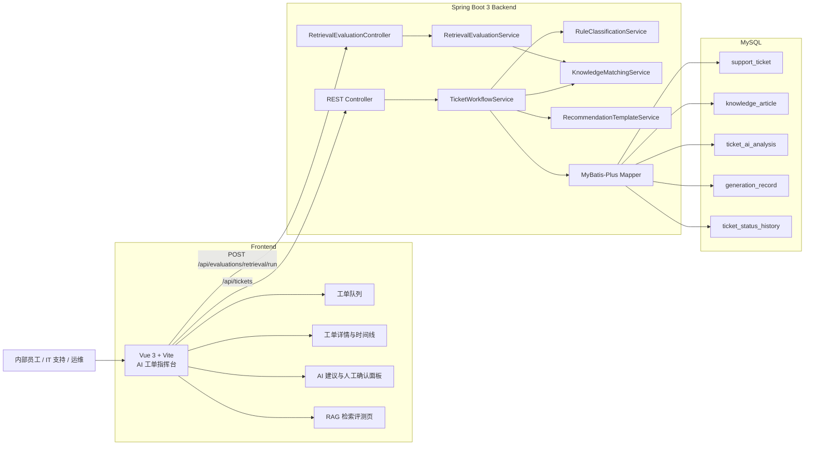
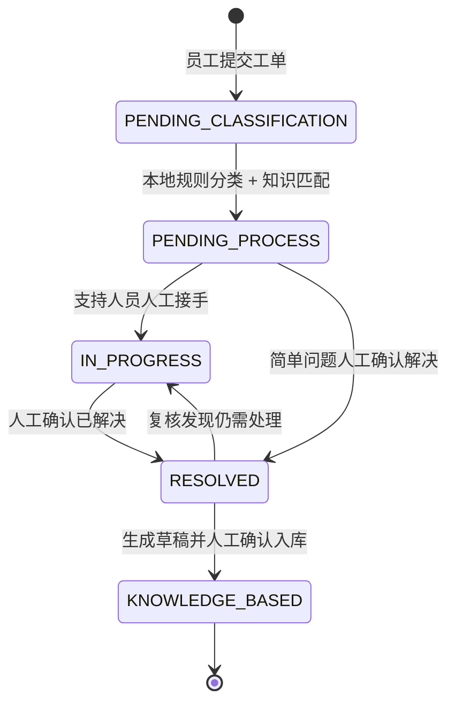
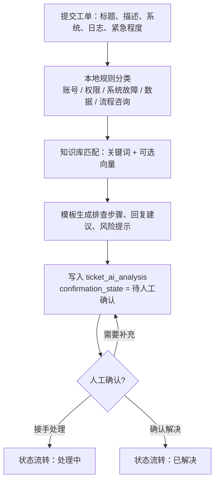
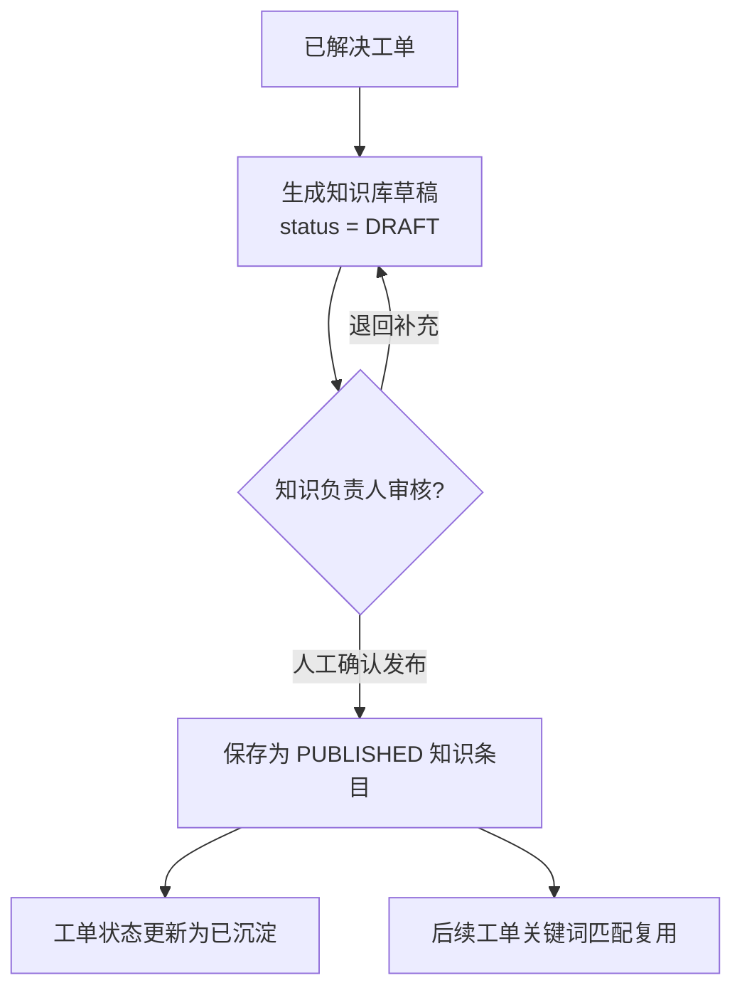

# 架构说明

Enterprise AI Ticket Copilot 是一个面向企业内部员工、IT 支持、运维和业务支持团队的 AI 工单与知识库助手。工单分类支持配置 OpenAI-compatible ChatModel，并在不可用或返回内容无法解析时降级到规则分类；知识匹配支持关键词与向量混合检索，向量通道不可用时退化到关键词。状态变更和知识发布仍需人工确认。另有一条固定关键词基线评测链路，专门检查仓库内的合成检索样例。

## 前后端架构图

## 工单状态流转图

## AI 分析 + 人工确认流程图

## 知识沉淀流程图

## 边界约束

- ChatModel 可连接配置的 OpenAI-compatible 服务；配置真实 API 时，工单上下文会发送到该服务。没有配置有效 Key 时走规则分类。
- 检索评测固定走关键词基线、不调用模型；使用合成问题与演示知识，不是生产质量指标。
- 不自动执行授权、回滚、重启、通知、爬虫或外部系统操作。
- 规则分析、处理建议、知识草稿都只作为人工确认前的辅助信息。
- `generation_record` 保存规则或模板输出来源、输入摘要、输出摘要、耗时和状态，便于审计。
